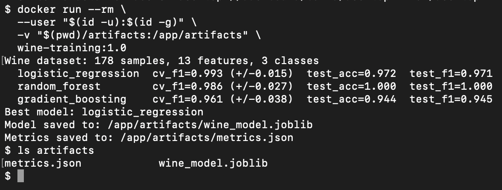

# Docker Lab 1: Wine Classifier Training

This lab packages an ML training job in a Docker image. The container trains
three classifiers on scikit-learn's **Wine** dataset (178 samples, 13 chemical
features, 3 cultivars). It compares them using 5-fold cross-validation and
saves the best model plus a `metrics.json` report to a mounted directory.

## Changes from the original lab

| Area | Original | This version |
|------|----------|--------------|
| Dataset | Iris (4 features) | Wine (13 features, stratified split) |
| Model | Single RandomForest | Logistic Regression (scaled), RandomForest and GradientBoosting, compared |
| Model selection | None | Best model picked on 5-fold CV macro-F1; the test set is kept for a final check |
| Metrics | None printed | CV F1 (mean/std), test accuracy, test F1 and confusion matrix in `metrics.json` |
| Configuration | Hard-coded | CLI arguments: `--models`, `--test-size`, `--random-state`, `--output-dir` |
| Output | Saved inside the container and lost on exit | Written to `/app/artifacts` and kept with a bind mount |
| Base image | `python:3.10` | `python:3.11-slim` |
| Dependencies | Unpinned | Pinned versions for reproducible builds |
| Layer caching | `COPY src/` before `pip install` | Requirements installed before the code is copied |
| Security | Runs as root | Runs as non-root `appuser` |
| Build context | Everything | Trimmed with `.dockerignore` |

## Prerequisites

- Docker Desktop (macOS/Windows) or Docker Engine (Linux), running
  (`docker info` should show a `Server` section)
- Git, for cloning the repository

No local Python install is needed. Everything runs inside the container.

## Get the lab

```sh
git clone https://github.com/Nishaant-Soni/MLOps_course.git
cd MLOps_course/Labs/Docker_Labs/Lab1
```

All of the commands below run from this directory.

## Build

```sh
docker build -t wine-training:1.0 .
```

## Run

Train all three models and save the results to `./artifacts` on the host:

```sh
mkdir -p artifacts
docker run --rm \
  --user "$(id -u):$(id -g)" \
  -v "$(pwd)/artifacts:/app/artifacts" \
  wine-training:1.0
```

`--user` lets the container write to the mounted folder as your user. Without
the mount, the run still works, but the outputs are removed with the container.

Arguments after the image name replace the defaults. For example, to train
only two models with a larger test split:

```sh
docker run --rm --user "$(id -u):$(id -g)" \
  -v "$(pwd)/artifacts:/app/artifacts" \
  wine-training:1.0 \
  --models random_forest gradient_boosting --test-size 0.3 --output-dir /app/artifacts
```

See all options:

```sh
docker run --rm wine-training:1.0 --help
```

## Expected output



```text
Wine dataset: 178 samples, 13 features, 3 classes
  logistic_regression  cv_f1=0.993 (+/-0.015)  test_acc=0.972  test_f1=0.971
  random_forest        cv_f1=0.986 (+/-0.027)  test_acc=1.000  test_f1=1.000
  gradient_boosting    cv_f1=0.961 (+/-0.038)  test_acc=0.944  test_f1=0.945
Best model: logistic_regression
Model saved to: /app/artifacts/wine_model.joblib
Metrics saved to: /app/artifacts/metrics.json
```

The model is chosen on cross-validation, not test accuracy. This is why
Logistic Regression wins even though RandomForest scores higher on the
36-sample test set.

## Sample results

From `artifacts/metrics.json` after a default run (`test_size=0.2`,
`random_state=42`):

| Model | CV F1 (mean ± std) | Test accuracy | Test F1 |
|-------|--------------------|---------------|---------|
| **logistic_regression** (best) | 0.9927 ± 0.0147 | 0.9722 | 0.9710 |
| random_forest | 0.9863 ± 0.0274 | 1.0000 | 1.0000 |
| gradient_boosting | 0.9612 ± 0.0378 | 0.9444 | 0.9453 |

Confusion matrices on the test set (rows = true class, columns = predicted):

| | logistic_regression | random_forest | gradient_boosting |
|---|---|---|---|
| class_0 | 12 / 0 / 0 | 12 / 0 / 0 | 12 / 0 / 0 |
| class_1 | 0 / 14 / 0 | 0 / 14 / 0 | 1 / 13 / 0 |
| class_2 | 0 / 1 / 9 | 0 / 0 / 10 | 0 / 1 / 9 |

The file looks like this (shortened to one model):

```json
{
  "dataset": "sklearn wine",
  "trained_at": "2026-10-29T18:53:50+00:00",
  "test_size": 0.2,
  "random_state": 42,
  "class_names": ["class_0", "class_1", "class_2"],
  "best_model": "logistic_regression",
  "results": {
    "logistic_regression": {
      "cv_f1_macro_mean": 0.9927,
      "cv_f1_macro_std": 0.0147,
      "test_accuracy": 0.9722,
      "test_f1_macro": 0.971,
      "confusion_matrix": [[12, 0, 0], [0, 14, 0], [0, 1, 9]]
    }
  }
}
```

## Save the image as a tarball (optional)

```sh
docker save wine-training:1.0 > wine_training.tar
```
